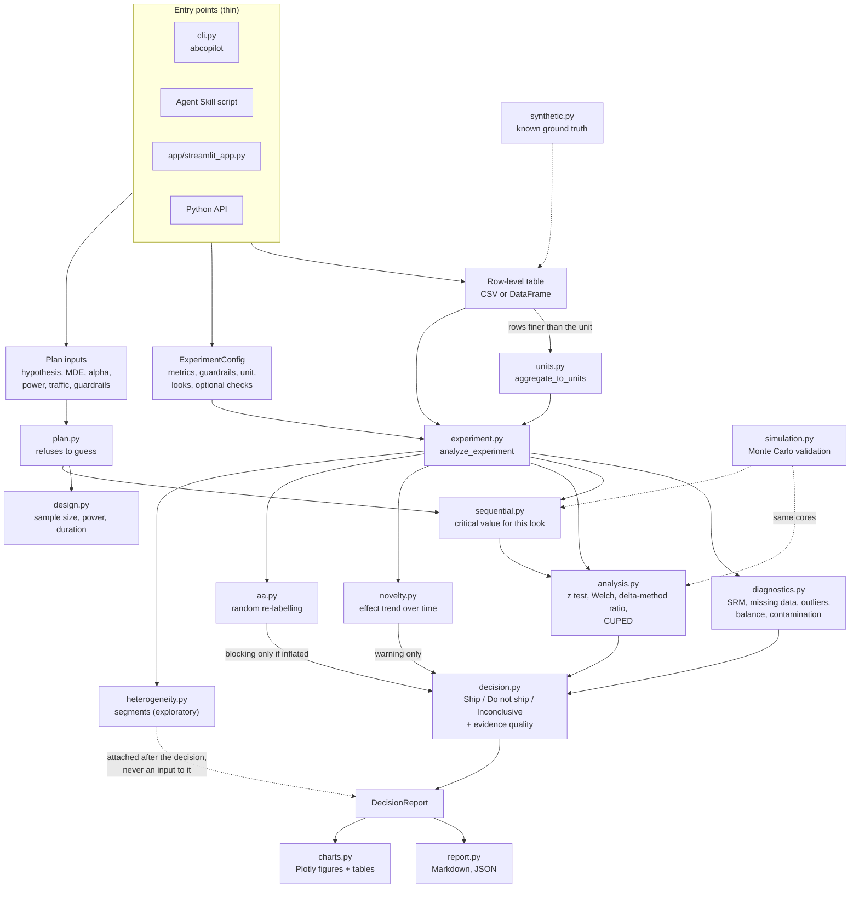

# Architecture

A/B Testing Copilot is a Python package (`ab_testing_copilot`, src layout) with four thin
entry points on top: a CLI, an Agent Skill script, a Streamlit dashboard and the Python
API. All statistics live in the package; the entry points collect inputs, call it and
present what it returns.

## Design principles

1. **Statistics first.** A method goes in only with a reference, a cross-check against an
   independent implementation or published value, and a simulation whose tolerance is
   fixed before the first run.
2. **Refuse rather than guess.** Structural problems raise `ValueError` with a specific
   message. Validity problems become diagnostics. Checks that cannot be run say "not
   assessed" instead of passing silently. The planner lists missing inputs instead of
   filling them in.
3. **Inconclusive is a legitimate answer.** The decision engine has three outcomes and an
   evidence rating; a blocking diagnostic overrides any effect size.
4. **Exploratory results never decide.** Segment analysis is computed after the decision
   inputs are fixed and is carried on the report as a separate, labelled object.
5. **One implementation per formula.** The scalar public functions and the Monte Carlo
   engine call the same vectorised cores, so the simulations validate the code that the
   reports use.

## Module responsibilities

| Module | Responsibility | Depends on |
|---|---|---|
| `models.py` | Frozen pydantic result models shared by every module (`EffectEstimate`, `Diagnostic`, `DecisionReport`, `SequentialLook`, `NoveltyResult`, `SegmentAnalysis`, `AAResult`, ...) | pydantic |
| `design.py` | Sample size, power, MDE, power curve, duration (normal approximation) | scipy |
| `analysis.py` | Vectorised cores and scalar APIs: two-proportion z, Welch t, delta-method ratio, relative lift, bootstrap, CUPED, p-value adjustment | numpy, scipy |
| `sequential.py` | Alpha-spending functions, boundary solver (recursive Gauss-Legendre integration), exit probabilities, power, inflation factor, the boundary for one look of a pre-registered design | `analysis` (types), `models` |
| `diagnostics.py` | SRM, differential missingness, outliers, covariate balance, peeking notice | `analysis` |
| `units.py` | Aggregation of finer rows to one row per randomised unit | pandas |
| `aa.py` | A/A check by random re-labelling, vectorised over re-labellings | `analysis` |
| `novelty.py` | Weighted trend of per-period effects and its classification | scipy |
| `heterogeneity.py` | Segment summary: adjusted p-values, simultaneous intervals, Cochran's Q | `analysis` |
| `decision.py` | Guardrail verdicts and the Ship / Do not ship / Inconclusive rule | `models` |
| `experiment.py` | The pipeline: validates a table against an `ExperimentConfig`, runs diagnostics, picks the alpha for this look, estimates effects, runs the optional checks, calls the decision engine | all of the above |
| `plan.py` | Experiment plan from explicit inputs; gap detection; Markdown rendering | `design`, `sequential`, `report` |
| `simulation.py` | Seeded Monte Carlo validation suite with pre-set tolerances | `analysis`, `design`, `sequential` |
| `synthetic.py` | Synthetic experiments and sessions with a known ground truth; built-in scenarios | numpy, pandas |
| `report.py` | Markdown rendering with escaping of data-derived text | `models`, `decision` |
| `charts.py` | Pure Plotly figure builders and their table twins (needs the `ui` extra) | plotly, `models` |
| `cli.py` | `abcopilot plan / design / sequential / analyze / aa / srm / simulate` | everything except `charts` |

Outside the package: `app/streamlit_app.py` (dashboard), `skills/ab-testing-copilot/`
(Agent Skill: `SKILL.md`, a forwarding script, the methodology reference; linked from
`.claude/skills/`), `examples/`, `demo/`, `benchmarks/`.

## Data flow

### One analysis, step by step

1. **Structure.** Required columns exist and are numeric; both arms have rows. Otherwise
   `ValueError`.
2. **Assignment.** Unexpected variant labels are counted. With a unit column: units in
   both arms (contamination) and repeated rows per unit are blocking; SRM is tested on
   units.
3. **Alpha for this look.** One planned analysis: `alpha`. Unplanned looks: `alpha / looks`.
   A pre-registered sequential design: the nominal level of this look from
   `sequential_look`, using the observed information fraction when the planned sample size
   is declared.
4. **Estimation.** Missing values are dropped per metric and reported; the primary metric
   gets outlier screening and, if a covariate is declared, a balance check and CUPED.
5. **Optional checks** on the primary metric: novelty trend, exploratory segments, A/A
   re-labelling.
6. **Decision.** `decide` sees the primary estimate, guardrail verdicts and diagnostics.
   It never sees the segment analysis.
7. **Report.** A frozen `DecisionReport` that renders to Markdown, serialises to strict
   JSON and feeds the chart builders.

## Technical trade-offs

| Decision | Alternative | Why this way |
|---|---|---|
| Boundaries by numerical integration written here | Depend on an R package or a clinical-trials library | numpy, scipy and statsmodels do not provide it; a small quadrature engine is easy to check against published values, and the same engine gives power and the inflation factor |
| Composite Gauss-Legendre on the score scale | Simpson's rule on a fixed grid (the classical choice) | The grid adapts to closely spaced looks, and the default resolution agrees with a three-times finer one to 1e-9 (tested) |
| Two-sided symmetric boundaries, no futility rule | Asymmetric or futility boundaries | The decision rule is symmetric (Ship or Do not ship); a non-binding futility rule adds a second spending function for little gain in a product setting |
| Nominal-level approach: reuse the ordinary test at the look's level | Dedicated sequential p-values and bias-adjusted estimates | Keeps one estimation path for every metric type; the cost (conservative intervals, biased point estimate after an early stop) is stated in every sequential report |
| Bonferroni for unplanned looks | Pretend the looks were planned and use a spending boundary | A boundary is only valid if it was fixed in advance; Bonferroni needs no such assumption |
| Repeated rows per unit are refused | Fit a mixed model or cluster-robust regression | Aggregation and the delta method cover the common cases with one formula each; the delta method is checked against the cluster-robust sandwich variance from statsmodels |
| Delta method with a normal reference | Bootstrap over units | Deterministic, cheap (see the benchmarks) and verified by simulation; a bootstrap would add a seed and a cost to every report |
| Novelty check as a weighted linear trend with an inflated standard error | Exponential decay model | Two parameters, no optimiser, conservative under day-to-day noise; it is a warning, so robustness matters more than fit |
| Segment analysis attached to the report after `decide` | Let strong heterogeneity change the evidence rating | Makes "exploratory never changes the decision" a property of the data flow, not a convention |
| Pydantic frozen models for every result | Dataclasses or dicts | Validation at the boundaries, immutability, and JSON export for free |
| `charts.py` inside the package, behind the `ui` extra | Chart code inside the Streamlit script | Pure functions are testable without a browser and are reused by the demo; core users do not need Plotly |
| Streamlit script as a thin layer | Business logic in callbacks | Everything on screen can be reproduced from the CLI or the API; AppTest drives the real script |
| Synthetic data only | Sample real datasets | Known ground truth makes every test and demo checkable, and no personal data enters the repository |

## Testing architecture

| Layer | Directory | What it proves |
|---|---|---|
| Unit | `tests/unit` | Formulas against published values, scipy, statsmodels and hand calculations; input validation |
| Integration | `tests/integration` | The pipeline, the CLI, the skill script, the examples, the demo and the benchmarks end to end |
| Adversarial | `tests/adversarial` | Misuse and hostile input fail loudly or are flagged, never mislead |
| Statistical | `tests/statistical` | Seeded Monte Carlo: error rates, power and coverage within tolerances fixed in advance |
| UI | `tests/ui` | Chart builders, the dashboard through `AppTest`, a headless `streamlit run` smoke test |

CI (GitHub Actions) runs lint, strict type checking and the whole suite with a coverage
gate on Python 3.11, 3.12 and 3.13, and a separate audit job (bandit, pip-audit).

## Extension points

- **A new spending function**: add it to `alpha_spent`; `boundaries_from_spending` already
  accepts any cumulative alpha, and a test compares it with published values.
- **A new metric type**: a vectorised core in `analysis.py`, a branch in
  `experiment._estimate`, the A/A statistics in `aa.py`, a simulation with a tolerance.
- **A new diagnostic**: return a `Diagnostic`; severity `blocking` makes the result
  invalid, `warning` weakens the evidence, `info` is reported only.
- **A new chart**: a pure function in `charts.py` with a `*_rows` table twin.
