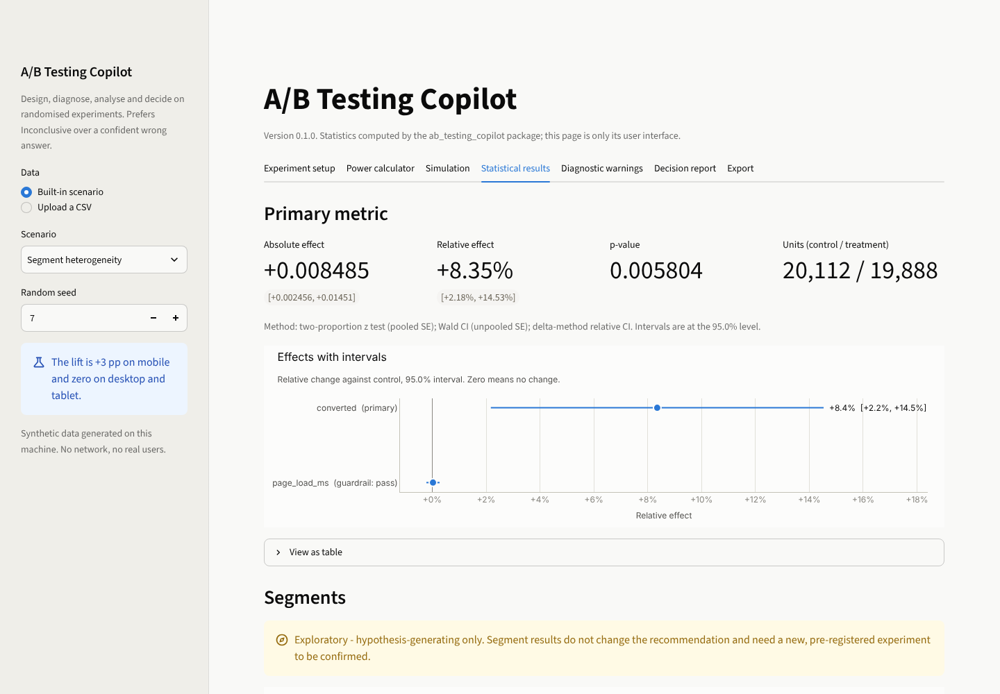
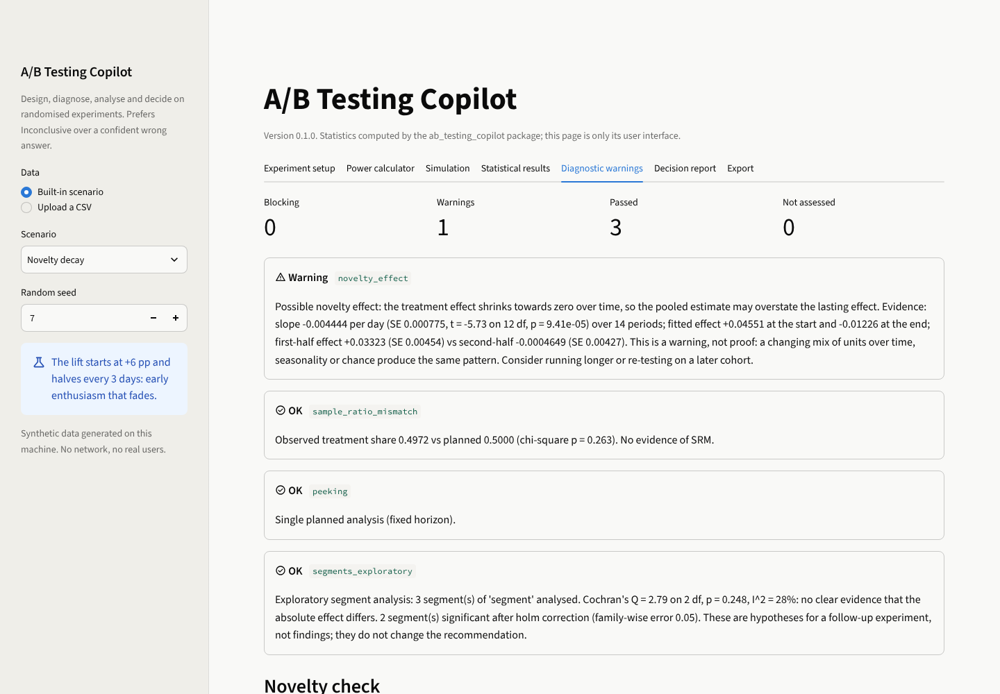
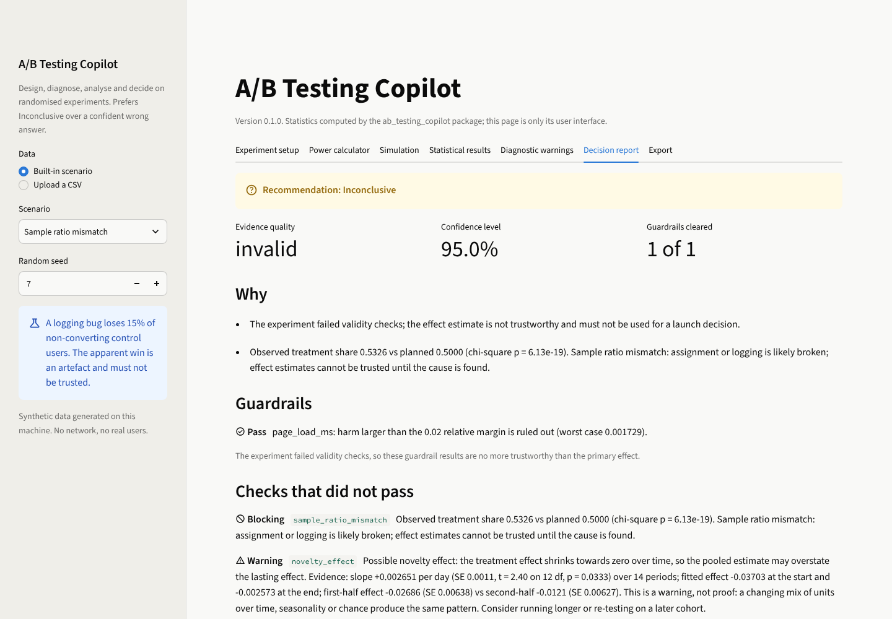

# A/B Testing Copilot

A statistics-first toolkit for randomised experiments: plan them, check that they are
valid, analyse them and decide. It ships as a Python package, a command-line tool, a
Streamlit dashboard and an Agent Skill, and it prefers "Inconclusive" over a confident
wrong answer.

> **Status:** v0.1.0, merged to `main` (pull request #1) and public; not published to PyPI.
> What has and has not been verified is in [QUALITY_REPORT.md](QUALITY_REPORT.md). The project was specified,
> directed and verified by its owner and implemented with an AI coding agent; see
> "How this was built" in [PORTFOLIO.md](PORTFOLIO.md).



## What it does

| Stage | What you get |
|---|---|
| **Plan** | `abcopilot plan`: hypothesis, primary metric and direction, guardrails and margins, allocation, MDE, power, alpha, sample size, duration, look schedule, decision rule and a pre-registration checklist. It lists missing inputs instead of guessing them. |
| **Design** | Sample size, power, MDE and duration for binary and continuous metrics, with unequal allocation; group-sequential designs with Lan-DeMets alpha spending (O'Brien-Fleming type or Pocock type) and their sample-size inflation. |
| **Validity** | Sample ratio mismatch, units in both arms, repeated rows per unit, differential missing data, outlier dominance, pre-period covariate balance, unplanned looks, and an A/A check that re-labels your own data at random. |
| **Analysis** | Two-proportion z test, Welch t test, delta-method ratio metrics, absolute and relative effects with intervals, percentile bootstrap, CUPED, Bonferroni / Holm / Benjamini-Hochberg. |
| **Looks** | A pre-registered sequential design uses the boundary of the current look; looks without a plan get a Bonferroni penalty. |
| **Decision** | `Ship`, `Do not ship` or `Inconclusive`, with reasons, guardrail verdicts and an evidence-quality rating. |
| **Context** | A novelty-effect check (a warning with its evidence, never proof) and per-segment effects with multiplicity correction and a heterogeneity test (always exploratory, never part of the decision). |
| **Simulation** | A seeded Monte Carlo suite of 24 checks (false-positive rate, power, interval coverage, peeking, sequential designs, ratio metrics, CUPED) with tolerances fixed before the first run. |

## Install

```bash
git clone https://github.com/mitchellma1219-beep/ab-testing-copilot.git && cd ab-testing-copilot
python -m venv .venv && source .venv/bin/activate
pip install -e ".[dev,ui]"      # ".[dev]" without the dashboard, "." for the library alone
```

Python 3.11 or newer. Runtime dependencies: numpy, scipy, pandas, pydantic. The `ui` extra
adds Streamlit and Plotly.

## Command line

The example files are synthetic and have a known ground truth
(`python examples/generate_sample_data.py` rewrites them). The outputs below are copied
from real runs; `...` marks lines left out.

**Plan an experiment.** Nothing is assumed on your behalf:

```console
$ abcopilot plan --metric converted
error: the plan is incomplete, and missing inputs are never guessed. Please supply:
  --hypothesis: what change is expected to move which metric, and why
  --metric-type: binary or continuous: it decides the test and the sample-size formula
  --direction: whether higher or lower values of the primary metric are better
  ...
```

Fourteen inputs are listed, and the exit code is 1. A complete call returns the plan in
[demo/output/experiment_plan.md](demo/output/experiment_plan.md).

**Size it.**

```bash
abcopilot design --baseline 0.10 --mde 0.02 --daily-units 1500   # 3,841 per arm, 6 days
abcopilot sequential --method obrien-fleming --looks 5           # boundaries and inflation
```

**Analyse it.** `sample_experiment.csv` has a true lift of +1.5 percentage points:

```console
$ abcopilot analyze examples/sample_experiment.csv \
    --metric converted --metric-type binary \
    --guardrail page_load_ms:continuous:lower:0.02 \
    --unit-col user_id --mde 0.015 \
    --date-col exposure_date --segment-col segment
# Decision report: sample_experiment.csv

**Recommendation: Ship**
Evidence quality: **strong**
...
- The primary metric improved: converted effect +0.01195 (95.0% CI [0.003485, 0.02041]).
- page_load_ms: harm larger than the 0.02 relative margin is ruled out (worst case 0.001766).
...
| converted | 0.098076 | 0.11002 | +0.011948 [+0.0034845, +0.020412] | +12.18% [+3.04%, +21.32%] | 0.005648 | 10,084 / 9,916 |
...
```

The full report also lists every diagnostic, the effect per day (novelty check) and the
exploratory segment table; see [demo/output/report_clean_win.md](demo/output/report_clean_win.md)
for one.

**Look early, honestly.** The same data declared as look 2 of a four-look design:

```console
$ abcopilot analyze examples/sample_experiment.csv --metric converted --metric-type binary \
    --unit-col user_id --sequential obrien-fleming --planned-looks 4 --look 2 --planned-n 40000
...
**Recommendation: Inconclusive**
...
- The interval includes zero: converted effect +0.01195 (99.70% CI [-0.0008474, 0.02474]).
- Interim look 2 of 4: the O'Brien-Fleming-type boundary (absolute z of at least 2.963) was not crossed. Continue to the next planned look. This is not evidence of no effect, and the design has no futility rule.
...
```

**Rows finer than the randomised unit.** `sample_sessions.csv` has one row per session and
a true click-through lift of +1 point. Sessions of the same user are not independent:

```bash
# As it is: Inconclusive, evidence "invalid" (8,052 repeated rows per user are blocking)
abcopilot analyze examples/sample_sessions.csv --unit-col user_id \
    --metric clicks --metric-type ratio --denominator impressions
# Aggregated to users, delta method: +0.0097 [+0.0027, +0.0167], Ship
abcopilot analyze examples/sample_sessions.csv --unit-col user_id \
    --aggregate clicks=sum,impressions=sum \
    --metric clicks --metric-type ratio --denominator impressions
# A/A check: is this analysis calibrated on this data? Users are re-labelled at random.
abcopilot aa examples/sample_sessions.csv --unit-col user_id \
    --metric clicks --metric-type continuous          # 21.5% false positives: inflated
abcopilot aa examples/sample_sessions.csv --unit-col user_id \
    --metric clicks --metric-type ratio --denominator impressions      # 5.1%: calibrated
```

**Check the statistics themselves.**

```bash
abcopilot srm 5000 5400                     # sample ratio mismatch, p = 8.77e-05
abcopilot simulate --n-sims 5000 --seed 0   # the 24 Monte Carlo checks
```

Exit codes: 0 ok; 1 invalid input; 2 `srm` found a mismatch; 3 a `simulate` check failed;
4 `aa` found an inflated false-positive rate.

## Dashboard

```bash
streamlit run app/streamlit_app.py
```

Seven tabs: experiment setup, power calculator (with a power curve), interactive Monte
Carlo, statistical results, diagnostic warnings, decision report, and export (Markdown and
JSON). It runs offline on six built-in synthetic scenarios (clean win, no effect, guardrail
regression, sample ratio mismatch, novelty decay, segment heterogeneity) or on an uploaded
CSV. Every chart has a table view.

| | |
|---|---|
|  |  |
| A novelty warning with its evidence | A sample ratio mismatch overrides a "significant" result |

More in [demo/](demo/): sample reports, standalone HTML charts and a five-minute
walkthrough.

## Python API

```python
import pandas as pd
from ab_testing_copilot import (
    ExperimentConfig, MetricSpec, SequentialDesign, analyze_experiment, sequential_boundaries,
)

report = analyze_experiment(
    pd.read_csv("examples/sample_experiment.csv"),
    ExperimentConfig(
        primary=MetricSpec(column="revenue", type="continuous"),
        unit_col="user_id", covariate_col="pre_spend",          # CUPED
        sequential=SequentialDesign(method="pocock", planned_looks=3, current_look=3),
    ),
)
print(report.decision, report.evidence_quality, report.primary.ci_low, report.primary.ci_high)
print(sequential_boundaries(5, alpha=0.05, method="obrien-fleming").critical_values)
```

## Agent Skill

`skills/ab-testing-copilot/` follows the Agent Skills layout (`SKILL.md` with `name` and
`description` frontmatter, `scripts/`, `references/`). In a checkout it is already linked
at `.claude/skills/ab-testing-copilot`, so Claude Code can pick it up as a project skill;
copy or link the folder into `~/.claude/skills/` to use it everywhere. The skill script
works from a checkout without installing the package.

## How it is verified

- **447 tests** in five layers (unit, integration, adversarial, statistical, UI), run in CI
  on Python 3.11, 3.12 and 3.13 with a coverage gate; `ruff` and strict `mypy` are clean.
- **Published values.** The sequential boundaries reproduce the values printed in the
  Stata and gsDesign documentation to four and six decimals.
- **Independent implementations.** scipy and statsmodels for the z test, the Welch test,
  the p-value adjustments, power for means, the cluster-robust sandwich variance behind the
  delta method, weighted least squares and Cochran's Q; scipy's multivariate normal
  integration for the boundaries.
- **Simulation.** 24 seeded Monte Carlo checks, plus the decision engine itself run across
  the looks of a sequential design.
- **Security.** ruff `S` rules, bandit and pip-audit, locally and in a CI `audit` job.

Numbers, commands, limits and what is *not* verified: [QUALITY_REPORT.md](QUALITY_REPORT.md).

```bash
pytest                         # two to three minutes
ruff check . && mypy
python benchmarks/run_benchmarks.py --quick
```

## Repository map

| Path | Content |
|---|---|
| `src/ab_testing_copilot/` | The package: design, analysis, sequential, diagnostics, decision, experiment pipeline, plan, simulation, report, charts, CLI |
| `app/streamlit_app.py` | Dashboard (thin UI over the package) |
| `skills/ab-testing-copilot/` | Agent Skill; `references/methodology.md` documents every method |
| `tests/` | unit, integration, adversarial, statistical, ui |
| `examples/`, `demo/`, `benchmarks/` | Synthetic data, demo assets, timing and evidence scripts |
| [ARCHITECTURE.md](ARCHITECTURE.md) | Modules, data flow, trade-offs |
| [CONTRIBUTING.md](CONTRIBUTING.md) | Setup and the rules for statistical changes |
| [SECURITY.md](SECURITY.md) | Design, scans and their results |
| [PORTFOLIO.md](PORTFOLIO.md) | Project summary for reviewers and interviews |

## Limitations

No futility boundaries, anytime-valid inference or bias-adjusted estimates after an early
stop; one treatment against one control; clustering is handled by aggregation or the delta
method, not by regression; CUPED and the sample-size formulas do not cover ratio metrics;
rows with missing values are dropped, which is unbiased only if they are missing completely
at random. The full list is in the
[methodology reference](skills/ab-testing-copilot/references/methodology.md). All bundled
data are synthetic.

## License

MIT
